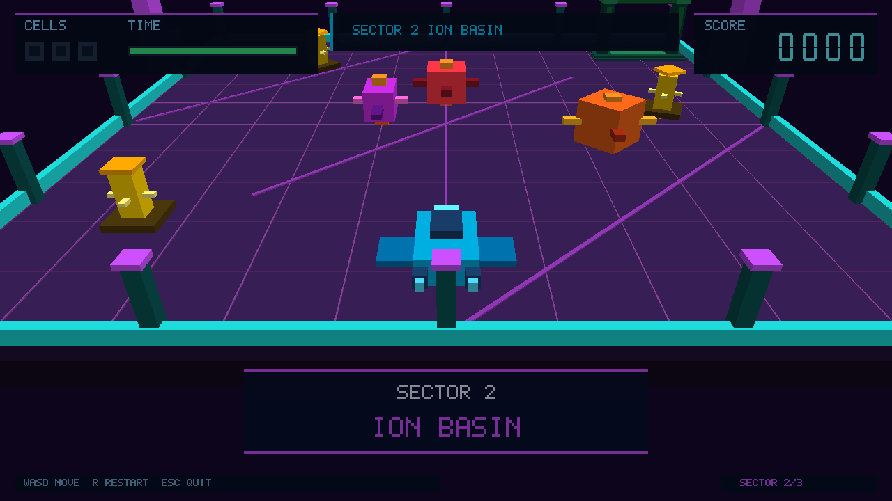

# CNA multi-language 3D demo

This repository implements **CNA Starfield Courier** in exactly three
languages:

| Language | Runtime/API | Status |
| --- | --- | --- |
| C++ | CNA's XNA 4.0-style C++ API | **DONE** |
| C | CNA C ABI | **DONE** |
| C# | one XNA 4.0 source compiled against CNA.NET and FNA | **DONE** |

No additional language ports are planned here. The earlier placeholder
directories for other languages were removed when this finite three-language
scope was completed.

## The game



Starfield Courier is a compact third-person 3D campaign. Each of its three
20×20 sectors contains three energy cells, moving hazards, a timed extraction
gate, a heading-relative chase camera, procedural `BasicEffect` geometry, a
HUD, and original sound cues. The game uses standard XNA-style lifecycle,
graphics, input, and audio APIs.

Controls:

- `W`/Up and `S`/Down move relative to the craft heading.
- `A`/Left and `D`/Right turn.
- Space boosts movement.
- `R` or Enter restarts.
- Escape exits.

The shared rules and validation requirements are documented in
[shared/game-spec.md](shared/game-spec.md) and
[shared/game-contract.md](shared/game-contract.md).

## Implementations

### C++

`cpp/` contains the CNA reference application. `StarfieldGame` derives from
`Microsoft::Xna::Framework::Game`; its ordinary lifecycle owns both gameplay
and rendering. The source is renderer-independent and is validated with CNA's
OpenGL 3.3 and OpenGL ES 3 profiles.

### C

`c/StarfieldGame.c` is a C99 application built directly on the public CNA C
ABI. It creates the CNA game and graphics manager, installs lifecycle
callbacks, reads CNA keyboard state, renders `BasicEffect` geometry through
the C binding, and uses the C audio/media APIs. Its deterministic test compiles
the same gameplay source with a test entry point; the graphical executable is
also validated in all three sectors.

### C#

`cs/StarfieldGame.cs` is the single game implementation used by both engines.
There are no `CNA`, `FNA`, or engine-specific conditional compilation paths in
the game source. The project selects either:

- CNA.NET's `CNA.XnaCompat` project with `-p:Engine=CNA`; or
- an XNA-compatible FNA assembly with `-p:Engine=FNA`.

Both configurations run the same lifecycle, gameplay, `BasicEffect` scene,
input, audio, and framebuffer validation. This makes the demo a compact
differential example for migrating ordinary XNA 4.0-style C# code to CNA.NET.

## Quick build

With sibling `cna`, `cna-cs`, and dependency checkouts available:

```sh
cmake -S . -B build/cna-game -G Ninja \
  -DCMAKE_BUILD_TYPE=Release \
  -DCNA_SOURCE_DIR=../cna \
  -DCNA_GRAPHICS_RENDERER=OPENGL33 \
  -DCNA_GRAPHICS_RENDERERS="OPENGL33;OPENGLES3"
cmake --build build/cna-game \
  --target starfield_cpp starfield_cpp_tests starfield_c starfield_c_tests

CNA_CS_ROOT="$PWD/../cna-cs" dotnet build cs/StarfieldCourier.csproj \
  -c Release -p:Engine=CNA
```

Full native and managed build, run, FNA differential, and validation commands
are in [BUILDING.md](BUILDING.md).

The build copies the shared runtime content beside each application. Audio
provenance and licensing are recorded in
[cpp/content/audio/LICENSE.md](cpp/content/audio/LICENSE.md).

## License

MIT. See [LICENSE](LICENSE).
